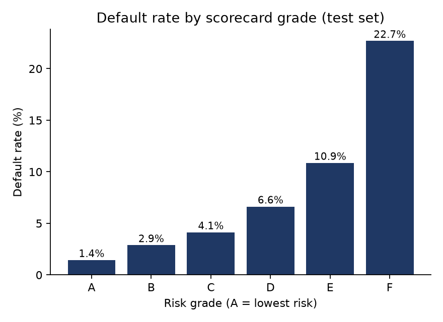
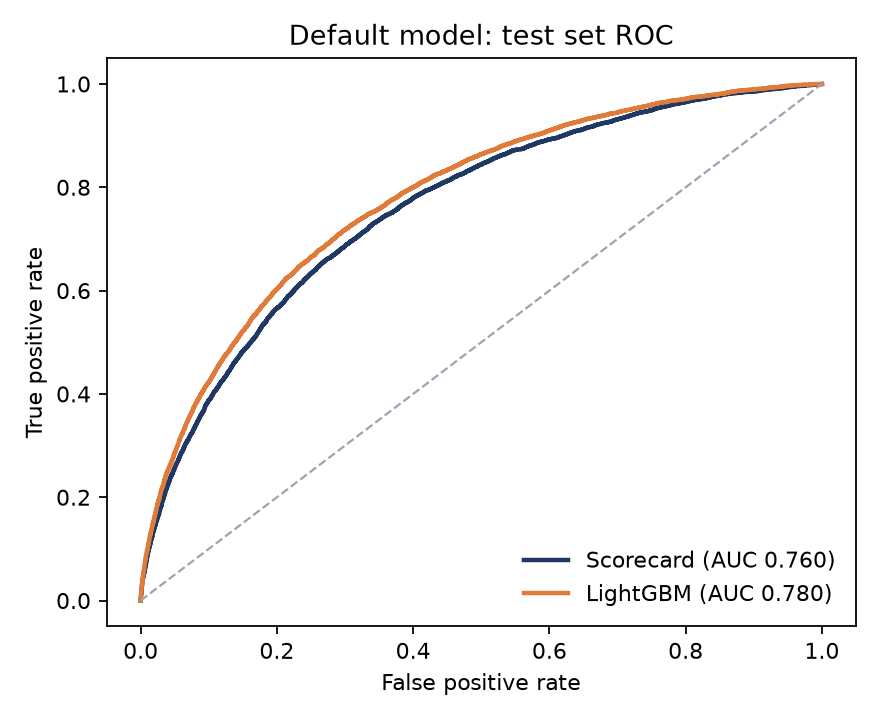
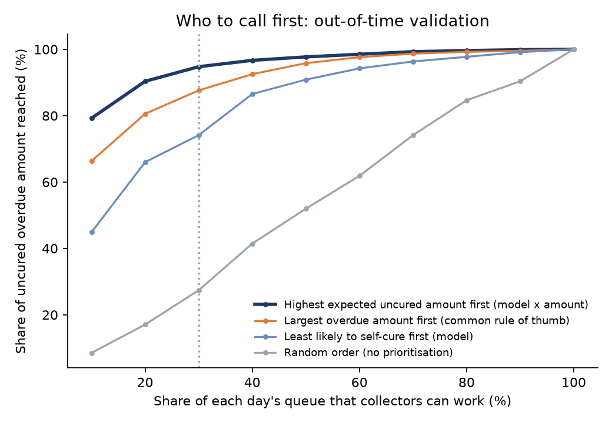

# Credit Risk & Collections Analytics

*Phân tích rủi ro tín dụng & thu hồi nợ*

**[English](#english)** · **[Tiếng Việt](#tieng-viet)**

<a id="english"></a>

## English

**Who should we lend to, and when a payment is missed, who should we call first?**

An end-to-end consumer-credit analytics project on the real
[Home Credit Default Risk](https://www.kaggle.com/competitions/home-credit-default-risk) data
(307k loan applications, 1.7M bureau records, 13.6M instalment payments): a tested dbt
warehouse, an industry-style application scorecard, an out-of-time collections model, and the
A/B test that would prove it works in production.

**[Live dashboard](https://credit-risk-collections-ngoyjwsjci4vcdtrqbqnzp.streamlit.app/)** ·
[Methodology](docs/methodology.md) · English / Tiếng Việt (switch at the top right of the dashboard)

### Key results

#### 1. Application scorecard: who to lend to
| Model | Test AUC | Gini | KS |
|---|---|---|---|
| **WoE scorecard** (33 features, points-based, fully explainable) | **0.760** | **0.520** | **0.389** |
| LightGBM challenger (same features) | 0.780 | 0.559 | 0.419 |

* The transparent scorecard keeps **93% of the black-box model's Gini** while every point can be
  explained to a credit committee or a customer.
* Six grades rank risk cleanly: default rate rises from **1.4% in grade A to 22.7% in grade F**
  (16x), monotonic across grades. Score stability train vs. test: PSI 0.0001.
* Approving the top 80% of applicants by score cuts the default rate of the approved book from
  **8.1% to 4.9%** and avoids **52% of defaults**.

<p> </p>

#### 2. Collections: who to call first
Scope: 231,315 instalments on fixed-term loans still unpaid at **DPD 5**. Outcome: does the
account roll to **DPD 30+**? (1.9% do.) Trained on the oldest 70% of events, validated on the
most recent 30% (out-of-time).

* Roll-rate model: **out-of-time AUC 0.891** (Gini 0.782).
* If collectors can only work **30% of each day's queue**, ranking by *model probability x
  amount at risk* puts **95% of the money that would otherwise roll** in front of them, versus
  **88%** for "largest amount first" and **27%** for no prioritisation. It also reaches 77% of
  rolling accounts, versus 42% for "largest amount first".
* Top drivers: the customer's past cure rate on earlier delinquencies, age, amount and share
  still unpaid at DPD 5.

<p></p>

#### 3. Proving it in production
Ranking well does not prove calling changes the outcome. To detect a **20% relative reduction
in roll rate** (5.56% → 4.45%) on the prioritised accounts: **~6,000 accounts per arm, about three
weeks**. Only the prioritised 30% of each day's queue enters the test, so at 2,000 new DPD 5
entries a day, 600 accounts a day are eligible. A 10% reduction needs ~25,000 per arm (about
three months).

#### Honest caveats
* The roll-rate model is somewhat optimistic in its riskiest decile (predicted 11% roll vs. 16%
  observed) and its score distribution shifts out-of-time (PSI 0.31) as the roll rate rises
  from 1.8% to 2.1%. Ranking holds; probabilities should be recalibrated before use as
  forecasts.
* Home Credit dates are relative to each customer's application, not a calendar, and the data
  has no record of collection actions. See [docs/methodology.md](docs/methodology.md).

### What's inside

```
raw CSVs ──► dbt + DuckDB warehouse ──► 1. Application scorecard (WoE/IV + logistic, A–F grades)
            (staging → intermediate     │    vs. LightGBM challenger + SHAP
             → marts, 26 data tests)    ├► 2. Collections: DPD 5 entry → roll to DPD 30+ model,
                                        │    queue prioritisation, out-of-time validation
                                        ├► 3. A/B test sizing for the new call strategy
                                        └► Streamlit dashboard (aggregates only)
```

| Area | What it shows |
|---|---|
| **Data engineering** | dbt models in three layers, point-in-time feature engineering with SQL window functions, 26 data tests (keys, labels, plausibility, no future information) |
| **Credit risk** | Optimal WoE binning, IV-based selection, points scaling (600 @ 50:1, PDO 20), A–F grades, cut-off trade-off, KS / Gini / PSI |
| **Collections** | Roll-rate model at DPD 5 validated out-of-time, four queue strategies compared on observed outcomes |
| **Experimentation** | Sample size and duration for a randomised test of the call strategy |
| **Engineering** | Python package, CLI, pytest (incl. an end-to-end run on synthetic data), ruff, GitHub Actions CI |

Full method, definitions and limitations: [docs/methodology.md](docs/methodology.md).

### Run it

Requires [uv](https://docs.astral.sh/uv/) and Python 3.12.

```bash
uv sync
# 1. Download the competition files from Kaggle into data/raw/:
#    application_train.csv, application_test.csv, bureau.csv,
#    previous_application.csv, installments_payments.csv
uv run crc all                                      # build warehouse (~2 min) + train
uv run python -m streamlit run app/streamlit_app.py # dashboard
```

Data in another folder? Set `CRC_RAW_DIR=path/to/folder`.

No Kaggle account? `uv run crc sample` writes a small synthetic dataset with the same schema;
point the pipeline at it with `CRC_RAW_DIR=data/sample`. The test suite does exactly this:

```bash
uv run pytest
```

### Project layout

```
dbt/                     warehouse: models/{staging,intermediate,marts}, data tests, macros
src/credit_risk_collections/
  scorecard.py           WoE scorecard, grades, cut-off analysis
  challenger.py          LightGBM + SHAP
  collections_model.py   roll-rate model, out-of-time split, queue prioritisation
  experiment.py          A/B test sample size
  metrics.py             AUC / Gini / KS / PSI / calibration
  reporting.py, cli.py   figures, results.json, dashboard data
app/streamlit_app.py     interactive dashboard
reports/                 figures, results.json and aggregate tables (no row-level data)
tests/                   unit tests + end-to-end pipeline test on synthetic data
```

### Data note

The Home Credit data is competition data and is **not** included in this repository. Only
aggregate results (grade tables, curves, feature importance) are committed.

---
Built by **Vu Trung Kien**, Data Analyst in consumer credit & collections ·
[LinkedIn](https://www.linkedin.com/in/kienvu68/) · [GitHub](https://github.com/kiezu01)

---

<a id="tieng-viet"></a>

## Tiếng Việt

**Nên cho ai vay, và khi khách hàng trễ hạn thì nên gọi ai trước?**

Dự án phân tích tín dụng tiêu dùng từ đầu đến cuối trên dữ liệu thật
[Home Credit Default Risk](https://www.kaggle.com/competitions/home-credit-default-risk)
(307 nghìn hồ sơ vay, 1,7 triệu bản ghi tín dụng (bureau), 13,6 triệu kỳ thanh toán): một kho dữ liệu dbt có
kiểm thử, một scorecard xét duyệt theo chuẩn ngành, một mô hình thu hồi nợ được kiểm định
out-of-time, và thiết kế A/B test để chứng minh hiệu quả khi đưa vào vận hành.

**[Dashboard trực tuyến](https://credit-risk-collections-ngoyjwsjci4vcdtrqbqnzp.streamlit.app/?lang=vi)** ·
[Phương pháp](docs/methodology.vi.md) · Dashboard có tiếng Anh / tiếng Việt (chuyển ở góc trên bên phải)

### Kết quả chính

#### 1. Scorecard xét duyệt: nên cho ai vay
| Mô hình | AUC (test) | Gini | KS |
|---|---|---|---|
| **Scorecard WoE** (33 biến, tính điểm, giải thích được hoàn toàn) | **0,760** | **0,520** | **0,389** |
| LightGBM đối chứng (cùng tập biến) | 0,780 | 0,559 | 0,419 |

* Scorecard minh bạch giữ được **93% Gini của mô hình hộp đen**, trong khi từng điểm số đều
  giải thích được cho hội đồng tín dụng hay cho khách hàng.
* Sáu hạng phân tách rủi ro rõ ràng: tỷ lệ vỡ nợ tăng từ **1,4% ở hạng A lên 22,7% ở hạng F**
  (gấp 16 lần), đơn điệu qua các hạng. Độ ổn định điểm giữa train và test: PSI 0,0001.
* Duyệt 80% hồ sơ có điểm cao nhất giúp giảm tỷ lệ vỡ nợ của danh mục được duyệt từ
  **8,1% xuống 4,9%** và tránh được **52% số ca vỡ nợ**.

<p> </p>

#### 2. Thu hồi nợ: nên gọi ai trước
Phạm vi: 231.315 kỳ thanh toán của khoản vay kỳ hạn cố định còn chưa trả ở **DPD 5**. Kết quả cần
dự báo: khoản đó có **roll sang DPD 30+** không? (1,9% có.) Huấn luyện trên 70% sự kiện cũ nhất,
kiểm định trên 30% gần nhất (out-of-time).

* Mô hình roll-rate: **AUC out-of-time 0,891** (Gini 0,782).
* Nếu nhân viên thu hồi chỉ xử lý được **30% hàng đợi mỗi ngày**, xếp hạng theo *xác suất của mô
  hình x số tiền có rủi ro* đưa **95% số tiền lẽ ra sẽ roll** đến tay họ, so với **88%** khi ưu tiên
  "số tiền lớn nhất trước" và **27%** khi không ưu tiên. Cách này cũng tiếp cận 77% số khoản sẽ
  roll, so với 42% của "số tiền lớn nhất trước".
* Yếu tố ảnh hưởng chính: tỷ lệ tự khắc phục trong các lần trễ hạn trước của khách hàng, tuổi, số
  tiền và tỷ lệ còn nợ ở DPD 5.

<p></p>

#### 3. Chứng minh hiệu quả khi vận hành
Xếp hạng tốt không chứng minh được cuộc gọi làm thay đổi kết quả. Để phát hiện mức **giảm tương
đối 20% roll rate** (5,56% → 4,45%) trên các khoản được ưu tiên: **khoảng 6.000 khoản mỗi nhóm,
khoảng ba tuần**. Chỉ 30% hàng đợi được ưu tiên mỗi ngày mới tham gia thử nghiệm, nên với 2.000
khoản mới vào DPD 5 mỗi ngày thì có 600 khoản đủ điều kiện. Để phát hiện mức giảm 10% cần khoảng
25.000 khoản mỗi nhóm (khoảng ba tháng).

#### Lưu ý thẳng thắn
* Mô hình roll-rate hơi lạc quan ở nhóm 10% rủi ro nhất (dự báo roll 11% so với thực tế 16%) và
  phân phối điểm dịch chuyển out-of-time (PSI 0,31) khi roll rate tăng từ 1,8% lên 2,1%. Khả năng
  xếp hạng vẫn giữ được; xác suất cần được hiệu chuẩn lại trước khi dùng làm dự báo.
* Ngày tháng trong Home Credit là tương đối so với ngày nộp hồ sơ của từng khách hàng, không phải
  lịch thực, và dữ liệu không ghi lại hành động thu hồi nợ. Xem [docs/methodology.vi.md](docs/methodology.vi.md).

### Bên trong có gì

```
CSV gốc ──► kho dữ liệu dbt + DuckDB ──► 1. Scorecard xét duyệt (WoE/IV + logistic, hạng A–F)
           (staging → intermediate     │    so với LightGBM đối chứng + SHAP
            → marts, 26 data test)     ├► 2. Thu hồi nợ: vào DPD 5 → roll sang DPD 30+,
                                       │    ưu tiên hàng đợi, kiểm định out-of-time
                                       ├► 3. Tính cỡ mẫu A/B test cho chiến lược gọi mới
                                       └► Dashboard Streamlit (chỉ dữ liệu tổng hợp)
```

| Mảng | Nội dung thể hiện |
|---|---|
| **Kỹ thuật dữ liệu** | Mô hình dbt ba tầng, tạo biến point-in-time bằng SQL window function, 26 data test (khóa, nhãn, tính hợp lý, không dùng thông tin tương lai) |
| **Rủi ro tín dụng** | Chia bin WoE tối ưu, chọn biến theo IV, quy đổi điểm (600 điểm @ 50:1, PDO 20), hạng A–F, đánh đổi điểm cắt, KS / Gini / PSI |
| **Thu hồi nợ** | Mô hình roll-rate ở DPD 5 kiểm định out-of-time, so sánh bốn chiến lược xếp hàng đợi trên kết quả thực tế |
| **Thử nghiệm** | Cỡ mẫu và thời gian cho thử nghiệm ngẫu nhiên chiến lược gọi |
| **Kỹ thuật phần mềm** | Python package, CLI, pytest (gồm chạy end-to-end trên dữ liệu tổng hợp), ruff, CI GitHub Actions |

Phương pháp, định nghĩa và hạn chế đầy đủ: [docs/methodology.vi.md](docs/methodology.vi.md).

### Cách chạy

Cần [uv](https://docs.astral.sh/uv/) và Python 3.12.

```bash
uv sync
# 1. Tải các file của cuộc thi từ Kaggle vào data/raw/:
#    application_train.csv, application_test.csv, bureau.csv,
#    previous_application.csv, installments_payments.csv
uv run crc all                                      # dựng kho dữ liệu (~2 phút) + huấn luyện
uv run python -m streamlit run app/streamlit_app.py # dashboard
```

Dữ liệu để ở thư mục khác? Đặt `CRC_RAW_DIR=đường/dẫn/tới/thư/mục`.

Không có tài khoản Kaggle? `uv run crc sample` tạo một bộ dữ liệu tổng hợp nhỏ cùng cấu trúc;
trỏ pipeline vào đó bằng `CRC_RAW_DIR=data/sample`. Bộ test làm đúng như vậy:

```bash
uv run pytest
```

### Cấu trúc dự án

```
dbt/                     kho dữ liệu: models/{staging,intermediate,marts}, data test, macro
src/credit_risk_collections/
  scorecard.py           scorecard WoE, xếp hạng, phân tích điểm cắt
  challenger.py          LightGBM + SHAP
  collections_model.py   mô hình roll-rate, chia out-of-time, ưu tiên hàng đợi
  experiment.py          cỡ mẫu A/B test
  metrics.py             AUC / Gini / KS / PSI / hiệu chuẩn
  reporting.py, cli.py   hình, results.json, dữ liệu cho dashboard
app/streamlit_app.py     dashboard tương tác
reports/                 hình, results.json và bảng tổng hợp (không có dữ liệu từng dòng)
tests/                   unit test + test pipeline end-to-end trên dữ liệu tổng hợp
```

### Ghi chú về dữ liệu

Dữ liệu Home Credit là dữ liệu cuộc thi và **không** được đưa vào repo này. Chỉ các kết quả tổng
hợp (bảng theo hạng, đường cong, mức độ quan trọng của biến) được commit.

---
Thực hiện bởi **Vu Trung Kien**, Data Analyst mảng tín dụng tiêu dùng & thu hồi nợ ·
[LinkedIn](https://www.linkedin.com/in/kienvu68/) · [GitHub](https://github.com/kiezu01)
