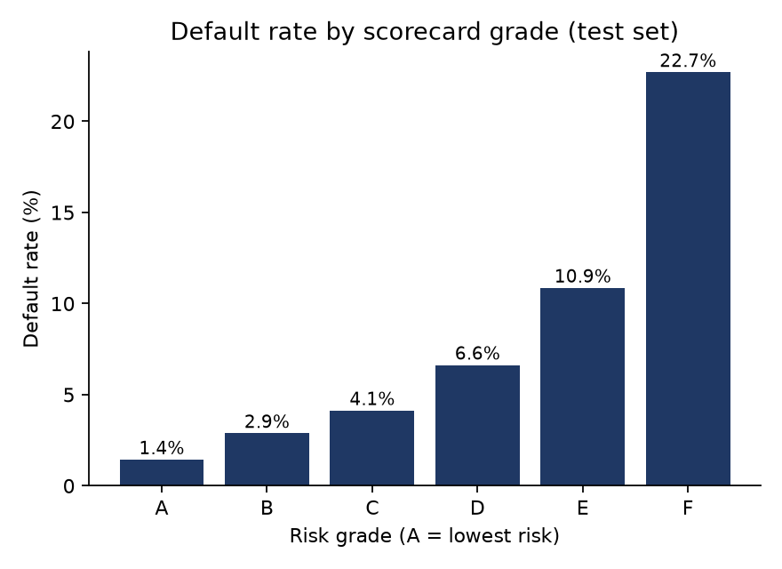
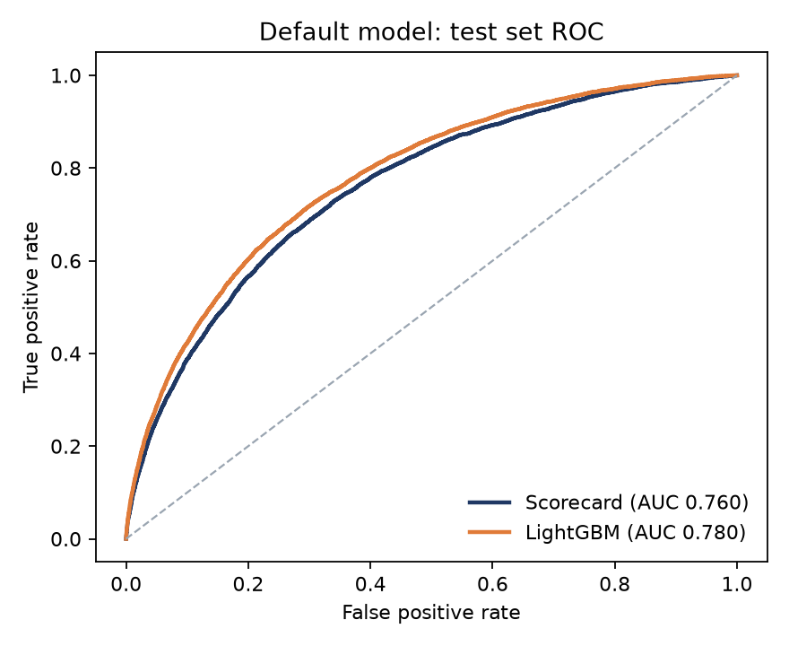
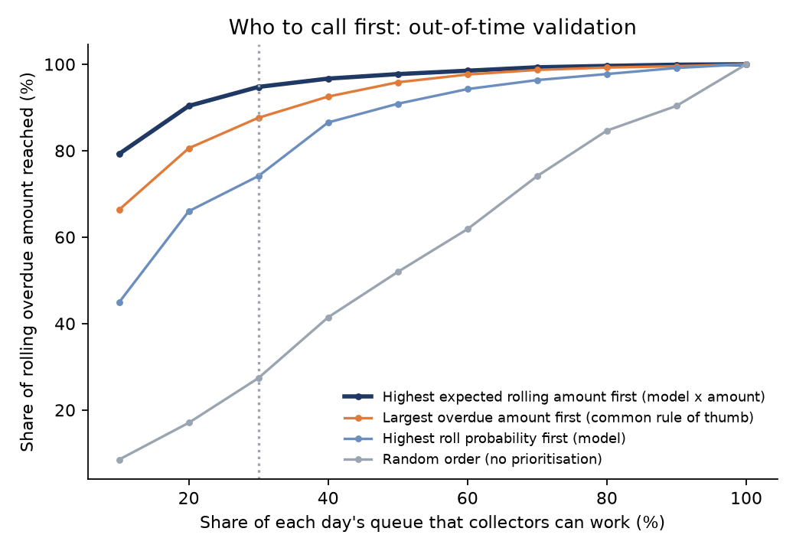

# Credit Risk & Collections Analytics

**Who should we lend to, and when a payment is missed, who should we call first?**

An end-to-end consumer-credit analytics project on the real
[Home Credit Default Risk](https://www.kaggle.com/competitions/home-credit-default-risk) data
(307k loan applications, 1.7M bureau records, 13.6M instalment payments): a tested dbt
warehouse, an industry-style application scorecard, an out-of-time collections model, and the
A/B test that would prove it works in production.

**[Live dashboard](https://credit-risk-collections-ngoyjwsjci4vcdtrqbqnzp.streamlit.app/)** ·
[Methodology](docs/methodology.md)

## Key results

### 1. Application scorecard: who to lend to
| Model | Test AUC | Gini | KS |
|---|---|---|---|
| **WoE scorecard** (33 features, points-based, fully explainable) | **0.760** | **0.520** | **0.389** |
| LightGBM challenger (same features) | 0.780 | 0.559 | 0.419 |

* The transparent scorecard keeps **93% of the black-box model's Gini** while every point can be
  explained to a credit committee or a customer.
* Six grades rank risk cleanly: default rate rises from **1.4% in grade A to 22.7% in grade F**
  (16x), monotonic across grades. Score stability train vs. test: PSI 0.0001.
* Approving the top 80% of applicants by score cuts the default rate of the approved book from
  **8.1% to 4.9%** and avoids **52% of defaults**.

<p> </p>

### 2. Collections: who to call first
Scope: 231,315 instalments on fixed-term loans still unpaid at **DPD 5**. Outcome: does the
account roll to **DPD 30+**? (1.9% do.) Trained on the oldest 70% of events, validated on the
most recent 30% (out-of-time).

* Roll-rate model: **out-of-time AUC 0.891** (Gini 0.782).
* If collectors can only work **30% of each day's queue**, ranking by *model probability x
  amount at risk* puts **95% of the money that would otherwise roll** in front of them, versus
  **88%** for "largest amount first" and **27%** for no prioritisation. It also reaches 77% of
  rolling accounts, versus 42% for "largest amount first".
* Top drivers: the customer's past cure rate on earlier delinquencies, age, amount and share
  still unpaid at DPD 5.

<p></p>

### 3. Proving it in production
Ranking well does not prove calling changes the outcome. To detect a **20% relative reduction
in roll rate** (5.56% → 4.45%) on the prioritised accounts: **~6,000 accounts per arm, about a week**
at 2,000 new DPD 5 entries a day. A 10% reduction needs ~25,000 per arm (about a month).

### Honest caveats
* The roll-rate model is somewhat optimistic in its riskiest decile (predicted 11% roll vs. 16%
  observed) and its score distribution shifts out-of-time (PSI 0.31) as the roll rate rises
  from 1.8% to 2.1%. Ranking holds; probabilities should be recalibrated before use as
  forecasts.
* Home Credit dates are relative to each customer's application, not a calendar, and the data
  has no record of collection actions. See [docs/methodology.md](docs/methodology.md).

## What's inside

```
raw CSVs ──► dbt + DuckDB warehouse ──► 1. Application scorecard (WoE/IV + logistic, A–F grades)
            (staging → intermediate     │    vs. LightGBM challenger + SHAP
             → marts, 26 data tests)    ├► 2. Collections: DPD 5 entry → roll to DPD 30+ model,
                                        │    queue prioritisation, out-of-time validation
                                        ├► 3. A/B test sizing for the new call strategy
                                        └► Streamlit dashboard (aggregates only)
```

| Area | What it shows |
|---|---|
| **Data engineering** | dbt models in three layers, point-in-time feature engineering with SQL window functions, 26 data tests (keys, labels, plausibility, no future information) |
| **Credit risk** | Optimal WoE binning, IV-based selection, points scaling (600 @ 50:1, PDO 20), A–F grades, cut-off trade-off, KS / Gini / PSI |
| **Collections** | Roll-rate model at DPD 5 validated out-of-time, four queue strategies compared on observed outcomes |
| **Experimentation** | Sample size and duration for a randomised test of the call strategy |
| **Engineering** | Python package, CLI, pytest (incl. an end-to-end run on synthetic data), ruff, GitHub Actions CI |

Full method, definitions and limitations: [docs/methodology.md](docs/methodology.md).

## Run it

Requires [uv](https://docs.astral.sh/uv/) and Python 3.12.

```bash
uv sync
# 1. Download the competition files from Kaggle into data/raw/:
#    application_train.csv, application_test.csv, bureau.csv,
#    previous_application.csv, installments_payments.csv
uv run crc all                                      # build warehouse (~2 min) + train
uv run python -m streamlit run app/streamlit_app.py # dashboard
```

No Kaggle account? `uv run crc sample` writes a small synthetic dataset with the same schema;
point the pipeline at it with `CRC_RAW_DIR=data/sample`. The test suite does exactly this:

```bash
uv run pytest
```

## Project layout

```
dbt/                     warehouse: models/{staging,intermediate,marts}, data tests, macros
src/credit_risk_collections/
  scorecard.py           WoE scorecard, grades, cut-off analysis
  challenger.py          LightGBM + SHAP
  collections_model.py   roll-rate model, out-of-time split, queue prioritisation
  experiment.py          A/B test sample size
  metrics.py             AUC / Gini / KS / PSI / calibration
  reporting.py, cli.py   figures, results.json, dashboard data
app/streamlit_app.py     interactive dashboard
reports/                 figures, results.json and aggregate tables (no row-level data)
tests/                   unit tests + end-to-end pipeline test on synthetic data
```

## Data note

The Home Credit data is competition data and is **not** included in this repository. Only
aggregate results (grade tables, curves, feature importance) are committed.

---
Built by **Vu Trung Kien**, Data Analyst in consumer credit & collections ·
[LinkedIn](https://www.linkedin.com/in/kienvu68/) · [GitHub](https://github.com/kiezu01)
